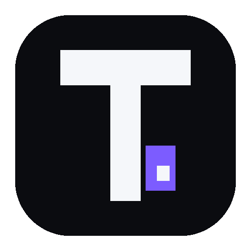

<p align="center"></p>
<h1 align="center">Toki for Scripting</h1>
<p align="center">这个邮箱注册过什么？那个手机号绑了哪些 App？哪些账号正在使用哪些 Token？一眼看清。</p>
<p align="center"><b>当前版本：1.0.1</b></p>

Toki 取自 Token 的趣味音译，是一个本地优先的身份、网站账号与 API 密钥关系管理器。它在「账号星图 · Atlas」的关系管理思路上，加入了 Token 管理、具体账号关联和三列关系图。

本 Scripting 版本把同版本网页应用完整打包到脚本内，由本地 WebView 加载，因此四页 UI、动画、表单、关系图和数据模型均与网页版一致，不是另做一套界面。

## 能做什么

- **卡包**：管理邮箱、手机号和第三方登录身份，并用颜色区分使用场景
- **网站与 App**：内置常用平台，记录具体账号名、分类、域名、绑定身份、备注和自定义图标
- **Tokens**：管理 API Key、Access Token、GitHub/Gist Token；平台与用途名称分开，默认优先从已有账号选择平台
- **具体账号关联**：同一平台可以记录多个账号，每条密钥精确关联其中一个账号
- **关系图**：身份 → 平台 → 密钥；同平台只显示一个节点，密钥连线继承所属邮箱/身份颜色
- **隐私模式**：号码、邮箱和账号名一键打码，密钥默认隐藏
- **有效期提醒**：默认无限期，也可指定日期并显示临期/过期状态
- **加密同步（可选）**：使用同步密码在本机 AES-GCM 加密后，保存到自己的 Gitee 或 GitHub 私密 Gist
- **JSON 备份**：可与网页版互相导入导出
- **离线可用**：HTML、CSS、JavaScript、Logo 和平台图标均随脚本安装；同步与远程图标更新需要网络

## 数据和隐私

- 数据默认只保存在 Scripting 的持久 WebView 数据仓库中
- 未开启同步时，不上传身份、账号或密钥数据
- 开启同步后，远端只保存加密后的 `atlas.enc.json`
- Toki 不记录网站密码；JSON 备份包含完整密钥，请像保管密码一样妥善保管

## 与网页版同步发行

从 1.0.1 起，网页版和 Scripting 版使用同一个版本号同步发行：

1. `web/` 是功能与 UI 的唯一源版本
2. 发版时将该版本网页完整快照复制到 Scripting 包的 `web/`
3. 同步更新 `script.json`、`VERSION` 和 `CHANGELOG.md`
4. 重新生成 `Toki.scripting`
5. 创建 `vX.Y.Z` Git 标签；需要回退时直接安装对应标签里的 `Toki.scripting`

## 兼容格式

导入导出继续使用网页版格式：

```json
{
  "app": "toki",
  "version": 3,
  "identities": [],
  "accounts": [],
  "tokens": []
}
```

## 致谢与许可

Toki 的网站端最初源自 [Ckxkx/account-atlas](https://github.com/Ckxkx/account-atlas)，历史版本保存在 [SylvanRoe/Toki-legacy](https://github.com/SylvanRoe/Toki-legacy)。原项目关于卡包、关系图、本地优先、隐私模式和加密同步的优秀设计，为 Toki 提供了基础。

代码遵循 [GPL-3.0](https://github.com/SylvanRoe/Toki/blob/main/LICENSE)。可以使用、修改和再分发；发布衍生作品时需同样开源并保留版权与许可声明。内置第三方网站与 App 图标归各自所有者。
